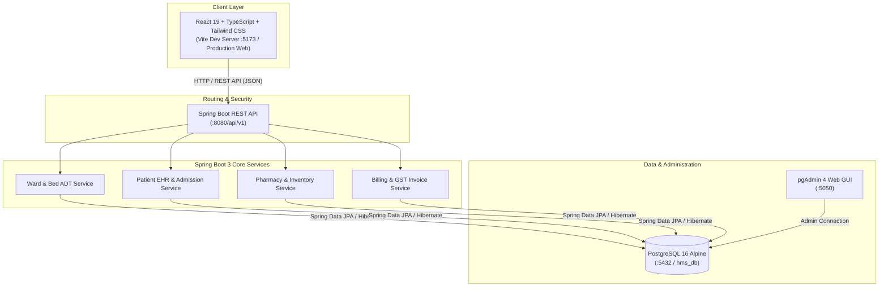

# 🏥 Hospital Management System (HMS)

An enterprise-grade, full-stack Hospital Management System designed for healthcare facilities to streamline inpatient **ADT** (Admission, Discharge & Transfer), **Electronic Health Records (EHR)**, **Pharmacy Inventory**, and **GST-compliant Billing & Invoicing**.

Built with **Spring Boot 3 (Java 17)**, **PostgreSQL 16**, **React 19 (TypeScript & Tailwind CSS)**, and fully containerized with **Docker & Docker Compose**.

---

## 📑 Table of Contents

- [System Architecture](#-system-architecture)
- [Key Modules & Features](#-key-modules--features)
- [Tech Stack](#-tech-stack)
- [Project Structure](#-project-structure)
- [Getting Started](#-getting-started)
  - [Prerequisites](#prerequisites)
  - [Option 1: Quickstart with Docker Compose (Recommended)](#option-1-quickstart-with-docker-compose-recommended)
  - [Option 2: Manual Local Development](#option-2-manual-local-development)
- [Default Ports & Credentials](#-default-ports--credentials)
- [Environment Configuration](#-environment-configuration)
- [REST API Reference](#-rest-api-reference)
- [Useful Development Commands](#-useful-development-commands)
- [License](#-license)

---

## 🏛 System Architecture



---

## 🌟 Key Modules & Features

### 1. Inpatient Ward & Bed Management (ADT)
- **Ward Configuration**: Manage wards by name, wing, type (`GENERAL`, `ICU`, `ICCU`, `EMERGENCY`, `MATERNITY`, `PEDIATRIC`, `SURGICAL`, `PRIVATE`), floor, and capacity.
- **Dynamic Bed Allocation**: Real-time bed status tracking (`AVAILABLE`, `OCCUPIED`, `UNDER_MAINTENANCE`, `RESERVED`).
- **Bed Types & Tariff**: Support for `GENERAL`, `SEMI_PRIVATE`, `PRIVATE`, `ICU`, and `VENTILATOR` with custom daily rates.
- **Visual Bed Grid**: Real-time floor and ward filtering with visual badges and one-click assign/release actions.

### 2. Patient EHR & Admissions
- **Patient Registration**: Capture medical record numbers, demographic details, emergency contacts, blood group, allergies, and diagnoses.
- **Direct Bed Admission**: Admit patients directly into available beds with automatic status sync.
- **Discharge Workflow**: Automated discharge that frees the assigned bed back to available status.

### 3. Pharmacy & Medicine Inventory
- **Formulary Management**: Track brand and generic medicine names, category, dosage, unit price, manufacturer, and expiry dates.
- **Stock Tracking & Alerts**: Instant inventory updates with visual low-stock badges.

### 4. Billing & Invoicing
- **Itemized Patient Invoicing**: Consolidated hospital charges including room/bed tariffs, doctor consultations, nursing care, and pharmacy supplies.
- **Automatic GST Calculation**: Itemized tax breakdowns with real-time subtotal, GST percentage, and grand total computations.
- **Invoice Status Lifecycle**: Full tracking across `PENDING`, `PAID`, and `CANCELLED` states.

---

## 🛠 Tech Stack

| Layer | Technologies |
| :--- | :--- |
| **Backend** | Java 17, Spring Boot 3.3.4, Spring Data JPA (Hibernate), Spring Security (JWT), Spring Validation, MapStruct, Lombok |
| **Frontend** | React 19, TypeScript, Vite, Tailwind CSS v4, Lucide React, Axios, React Router v7 |
| **Database** | PostgreSQL 16 Alpine |
| **DevOps & Containers** | Docker, Docker Compose, Multi-stage Dockerfile (Eclipse Temurin 17 JRE) |
| **Database Tooling** | pgAdmin 4 |

---

## 📂 Project Structure

```text
hospital-managment-system/
├── docker/
│   └── postgres/
│       └── init.sql                  # Automated database initialization script
├── docs/                             # System Requirements, UML, and ER diagrams
├── hospital-ui/                      # React 19 Frontend application
│   ├── src/
│   │   ├── components/               # Navbar, Sidebar, Topbar, Modals
│   │   ├── pages/                    # WardGrid, Patients, Pharmacy, Billing, Dashboard
│   │   ├── services/                 # Axios API clients for backend integration
│   │   ├── types/                    # TypeScript interfaces matching backend DTOs
│   │   └── App.tsx                   # Main router and layout
│   ├── package.json
│   └── vite.config.ts
├── hospital_management_system/       # Spring Boot 3 Backend application
│   ├── src/
│   │   └── main/java/com/hospital/hms/
│   │       ├── billing/              # Invoice controllers, services, repositories, DTOs
│   │       ├── common/               # Enums, ApiResponse envelope, GlobalExceptionHandler
│   │       ├── config/               # Security, WebMvc CORS, JPA configurations
│   │       ├── patient/              # Patient EHR controllers, services, entities
│   │       ├── pharmacy/             # Medicine inventory management
│   │       └── ward/                 # Ward & Bed allocation management
│   ├── Dockerfile                    # Production multi-stage build container
│   └── pom.xml                       # Maven dependencies
├── .env.example                      # Sample environment variables template
├── docker-compose.yml                # Orchestrates Postgres, Backend, and pgAdmin
├── .gitignore                        # Global repository ignore rules
└── README.md                         # Project documentation
```

---

## 🚀 Getting Started

### Prerequisites
- [Git](https://git-scm.com/)
- [Docker Desktop](https://www.docker.com/products/docker-desktop/) (for containerized deployment)
- *Optional for local dev without Docker:*
  - Java 17+ JDK & Maven 3.8+
  - Node.js 18+ & npm
  - Local PostgreSQL 16 instance

---

### Option 1: Quickstart with Docker Compose (Recommended)

1. **Clone the repository:**
   ```bash
   git clone <repository-url>
   cd hospital-managment-system
   ```

2. **Configure environment variables:**
   ```bash
   cp .env.example .env
   ```

3. **Start all services with Docker Compose:**
   ```bash
   docker compose up -d --build
   ```

4. **Verify running containers:**
   ```bash
   docker compose ps
   ```

   Once healthy, services will be accessible at:
   - **Backend API**: [http://localhost:8080/api/v1](http://localhost:8080/api/v1)
   - **pgAdmin**: [http://localhost:5050](http://localhost:5050)
   - **PostgreSQL**: `localhost:5432`

---

### Option 2: Manual Local Development

#### 1. Setup Database
Ensure PostgreSQL is running locally and create the database:
```sql
CREATE DATABASE hms_db;
CREATE USER hms_user WITH ENCRYPTED PASSWORD 'hms_pass';
GRANT ALL PRIVILEGES ON DATABASE hms_db TO hms_user;
```

#### 2. Start Backend (Spring Boot)
```bash
cd hospital_management_system

# Compile and run
mvn spring-boot:run
```
*The backend starts on port `8080` under context path `/api/v1`.*

#### 3. Start Frontend (React UI)
```bash
cd hospital-ui

# Install dependencies
npm install

# Start Vite development server
npm run dev
```
*The frontend starts on [http://localhost:5173](http://localhost:5173) and connects to `http://localhost:8080/api/v1`.*

---

## 🔑 Default Ports & Credentials

| Service | Host Port | Internal Port | URL / Host | Default Credentials |
| :--- | :--- | :--- | :--- | :--- |
| **Frontend UI** | `5173` | `5173` | [http://localhost:5173](http://localhost:5173) | — |
| **Backend REST API** | `8080` | `8080` | [http://localhost:8080/api/v1](http://localhost:8080/api/v1) | Context-path: `/api/v1` |
| **PostgreSQL DB** | `5432` | `5432` | `localhost` | User: `hms_user`<br>Pass: `hms_pass`<br>DB: `hms_db` |
| **pgAdmin 4** | `5050` | `80` | [http://localhost:5050](http://localhost:5050) | Email: `admin@hospital.com`<br>Pass: `admin123` |

---

## ⚙️ Environment Configuration

Configuration is managed via `.env` (derived from `.env.example`):

| Variable | Description | Default |
| :--- | :--- | :--- |
| `POSTGRES_DB` | PostgreSQL database name | `hms_db` |
| `POSTGRES_USER` | PostgreSQL user | `hms_user` |
| `POSTGRES_PASSWORD` | PostgreSQL password | `hms_pass` |
| `DB_PORT` | Host exposed port for PostgreSQL | `5432` |
| `BACKEND_PORT` | Host exposed port for Spring Boot | `8080` |
| `DDL_AUTO` | Hibernate schema update mode | `update` |
| `JWT_SECRET` | Secret key for JWT token signing | `404E635266556...` |
| `PGADMIN_EMAIL` | pgAdmin default login email | `admin@hospital.com` |
| `PGADMIN_PASSWORD` | pgAdmin default login password | `admin123` |
| `PGADMIN_PORT` | Host exposed port for pgAdmin | `5050` |

---

## 📡 REST API Reference

All endpoints are prefixed with `/api/v1`.

### 🏥 Wards & Beds (`/wards`, `/beds`)
| Method | Endpoint | Description |
| :--- | :--- | :--- |
| `POST` | `/wards` | Create a new ward |
| `GET` | `/wards` | List wards (supports pagination, filtering by name, type, floor) |
| `GET` | `/wards/active` | Get flat list of all active wards for dropdowns |
| `GET` | `/wards/{wardId}` | Get ward details by ID |
| `PUT` | `/wards/{wardId}` | Update ward details |
| `DELETE`| `/wards/{wardId}` | Deactivate (soft delete) a ward |
| `POST` | `/wards/{wardId}/beds` | Add a bed to a specific ward |
| `GET` | `/beds` | Dynamic query beds with filters (`wardId`, `status`, `bedType`) |
| `GET` | `/beds/{bedId}` | Get single bed details |
| `GET` | `/wards/{wardId}/beds/available` | List all available beds in a ward |
| `PUT` | `/beds/{bedId}` | Update bed number, type, rate, or notes |
| `POST`/`PATCH` | `/beds/{bedId}/assign` | Assign patient to bed (occupies bed) |
| `POST`/`PATCH` | `/beds/{bedId}/status` | Update bed status (`AVAILABLE`, `UNDER_MAINTENANCE`) |
| `PATCH` | `/beds/{bedId}/release` | Release bed back to `AVAILABLE` |
| `PATCH` | `/beds/{bedId}/maintenance` | Mark bed under maintenance |
| `DELETE`| `/beds/{bedId}` | Delete an unallocated bed |

### 🧑‍⚕️ Patients & EHR (`/patients`)
| Method | Endpoint | Description |
| :--- | :--- | :--- |
| `GET` | `/patients` | List all registered patients |
| `GET` | `/patients/{id}` | Get patient medical record by ID |
| `POST` | `/patients` | Register new patient |
| `PUT` | `/patients/{id}` | Update patient information |
| `DELETE`| `/patients/{id}` | Remove patient record |
| `POST` | `/patients/{patientId}/assign-bed` | Admit patient and allocate bed |
| `POST` | `/patients/{patientId}/discharge` | Discharge patient and automatically free their bed |

### 💊 Pharmacy & Medicine Inventory (`/medicines`)
| Method | Endpoint | Description |
| :--- | :--- | :--- |
| `GET` | `/medicines` | List all medicines in formulary |
| `GET` | `/medicines/{id}` | Get medicine details by ID |
| `POST` | `/medicines` | Add new medicine to formulary |
| `PUT` | `/medicines/{id}` | Update medicine details |
| `PATCH` | `/medicines/{id}` | Quick stock level adjustment |
| `DELETE`| `/medicines/{id}` | Remove medicine from inventory |

### 🧾 Billing & Invoicing (`/invoices`)
| Method | Endpoint | Description |
| :--- | :--- | :--- |
| `GET` | `/invoices` | List all hospital invoices |
| `GET` | `/invoices/{id}` | Get invoice details including line items |
| `POST` | `/invoices` | Generate new invoice with GST tax calculation |
| `PATCH` | `/invoices/{id}` | Update invoice status (`PENDING`, `PAID`, `CANCELLED`) |

---

## 💻 Useful Development Commands

### Docker Operations
```bash
# Start all containers in background
docker compose up -d

# Rebuild and start after code updates
docker compose up -d --build

# View real-time logs for backend
docker compose logs -f backend

# Stop all containers
docker compose down

# Stop and wipe persistent volume data (fresh state)
docker compose down -v
```

### Backend (Maven)
```bash
cd hospital_management_system

# Compile without running tests
mvn clean compile -DskipTests

# Run unit and integration tests
mvn test

# Package to runnable JAR
mvn clean package -DskipTests
```

### Frontend (npm)
```bash
cd hospital-ui

# Run development server
npm run dev

# Run TypeScript checking & production build
npm run build

# Run linter
npm run lint
```

---

## 📄 License
This project is proprietary and developed for hospital administrative and clinical operations.
